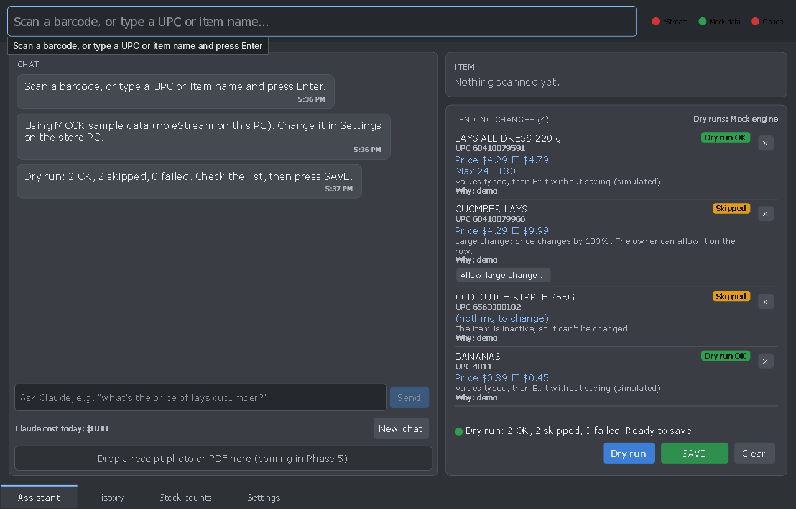
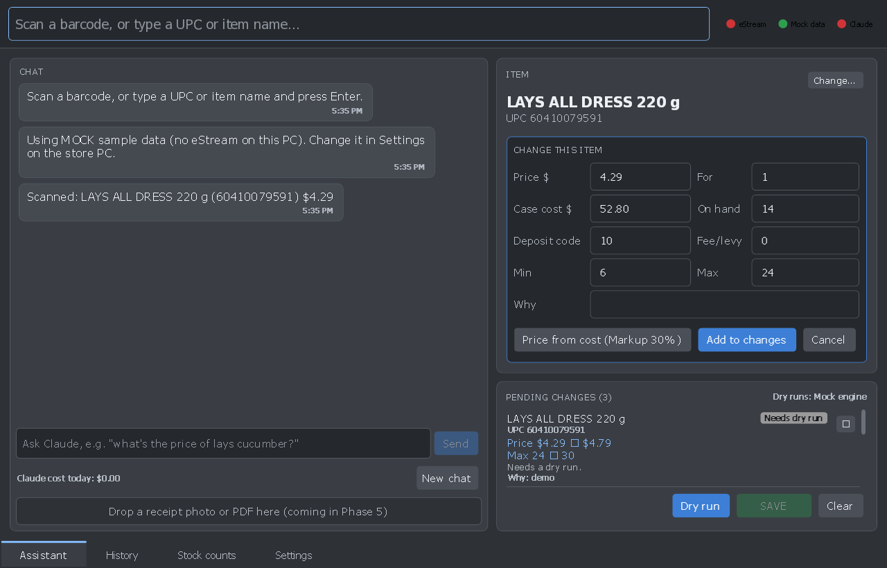
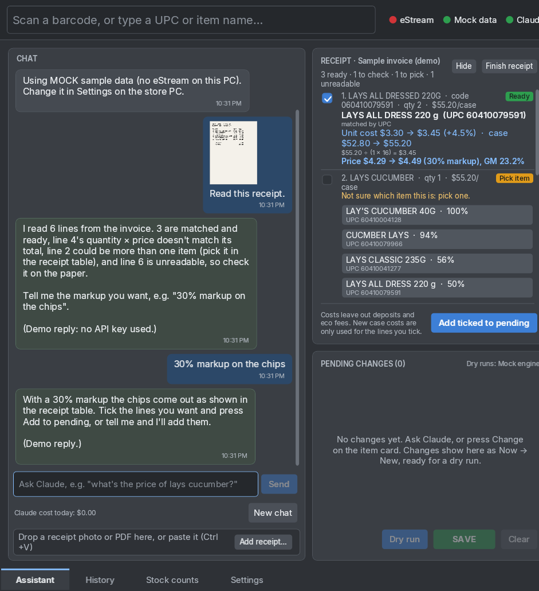

# eStream Assistant

Windows 11 desktop app for a store running eStream System 5. See `spec.md` (the requirements).
The original `Plan.txt` from the store PC is kept locally and is git-ignored, because it describes the store's setup.

## Layout

| Project | What it is |
|---|---|
| `src/EstreamAssistant.Core` | All the logic, cross-platform (`net10.0`): UPC normalization, fuzzy search, pricing math, scan detection, read-only SQL + mock repositories, name cache, settings. |
| `src/EstreamAssistant.App` | WPF app (`net10.0-windows`). Compiles on Linux, **runs only on Windows**. |
| `tests/EstreamAssistant.Tests` | xUnit tests for Core. |

## Build and test (any OS)

```
dotnet build
dotnet test
```

## Quick look on Linux (Wine)

```
tools/run-in-wine.sh                      # just open it
tools/run-in-wine.sh --search "lays cucumber" --pick 2 --scan 060410079591 --tab 4
tools/run-in-wine.sh --demo-chat --chat "lays cucumber" --choose 2
tools/run-in-wine.sh --stage "060410079591:price=4.79,max=30" --stage "60410079966:price=9.99" --dryrun
tools/run-in-wine.sh --mock-unverified 60410079966 --stage "060410079591:price=4.79" --stage "60410079966:price=4.49" --dryrun --save --tab 1
tools/run-in-wine.sh --tab 2 --count 060410079591=10 --count 4011=25 --make-sheet "Chips aisle" --post-first
tools/run-in-wine.sh --demo-chat --chat "which items have negative stock?" --report 9002 --tab 3
tools/run-in-wine.sh --demo-chat --attach 'Z:\path\to\invoice.jpg' --send --chat "30% markup on the chips" --pick-line 2 --stage-receipt
```

The `--search`, `--pick`, `--scan`, `--chat`, `--choose`, `--stage`, `--dryrun`, `--save` (auto-confirms), `--save-dialog`,
`--mock-unverified`, `--mock-fail`, `--count`, `--make-sheet` (auto-confirms), `--post-first` (opens the real
post dialog), `--attach`, `--send`, `--pick-line`, `--stage-receipt`, `--report` (negative, zero, below_min, above_max, sheets or a sheet number), `--edit` and `--tab` options are for demos only: they feed
input to the app after it starts. `--demo-chat` swaps Claude for a scripted stand-in that uses the real
read-only tools, so the chat can be checked without an API key or any cost. Wine is fine for checking layout,
but focus handling and scanner timing need a real Windows PC.

| Chat with numbered choices | After picking a choice | Settings |
|---|---|---|
|  |  |  |

| Pending changes after a dry run | Changing an item on the item card |
|---|---|
|  |  |

| SAVE confirmation | History |
|---|---|
|  |  |

| Make a stock sheet | Post a stock sheet (type the number) |
|---|---|
|  |  |

| Receipt table (demo chat) |
|---|
|  |

## Install on the store PC

Download the latest `eStreamAssistant-Setup-<version>.exe` from
[Releases](https://github.com/PocketStudiosLLC/Estream-Assistant/releases) and run it as the normal store user
(no admin needed). It installs to `C:\eStreamAssistantApp\`, and the store PC doesn't need .NET.
To update, run the newer installer. Settings and the API key are kept.

## Making a release (dev PC)

1. Set `<Version>` in `src/EstreamAssistant.App/EstreamAssistant.App.csproj` and write `docs/releases/v<version>.md`.
2. Commit, then `git tag v<version> && git push origin main v<version>`.
3. GitHub Actions (`.github/workflows/release.yml`) runs the tests, builds the installer with Inno Setup and
   publishes the release, with SHA256SUMS. Versions starting with `0.` are marked as pre-releases.

Until the workflow files are pushed (that needs `gh auth refresh -h github.com -s workflow` on the dev PC), releases
are built locally with the script below and uploaded with `gh release create`.

To try the installer locally first: `tools/build-installer-wine.sh` (Inno Setup under Wine; see the script for
the one-time setup). Output goes to `dist/`.

The plain self-contained exe, without an installer:
`dotnet publish src/EstreamAssistant.App -c Release -r win-x64 -o publish/win-x64`

## Data source

- **Mock** (default): built-in sample items. Only the first two UPCs/names are real; all prices are made up.
  You can point *Settings → Sample export* at a `sample-items.txt` made with the sqlcmd command in Plan.txt §12.
  That file is store data: it's git-ignored, so keep it private.
- **Sql** (on the store PC): the real eStream database, **read-only** (`ApplicationIntent=ReadOnly` is forced,
  and only built-in SELECT statements can run).

App files (settings, encrypted API key, name cache, logs) live in `%LOCALAPPDATA%\eStreamAssistant\`.

## Status (build phases from Plan.txt §13)

- [x] **Phase 1**: shell window, settings (API key encrypted with DPAPI), UPC lookup with check-digit fallbacks,
      fuzzy name search with numbered choices, scanner detection, item card, scan list, eStream/DB status lights.
      Pricing math is also built and tested (used from Phase 3).
- [x] **Phase 2**: Claude chat (streaming; text messages use the chat model, default `claude-sonnet-5-5`; messages with a photo or PDF use the receipt model, default `claude-opus-5-5` at medium effort) with read-only tools only: `lookup_item`, `find_items`,
      `get_codes`, `calc_price` (strict schemas, inputs re-checked in the app). The system prompt and tools are
      prompt-cached; effort comes from Settings (default low). Server-side fallback (`fallbacks: "default"`)
      retries safety-classifier refusals on a backup model. Numbered choices in Claude's replies become buttons;
      scans are passed to Claude as context. There is a cost estimate in the chat footer (`usage.json`), plus
      *Test connection* and *New chat*. Tested end to end against a local fake API server; **not yet tried with
      a real API key.**
- [x] **Phase 3** (v0.1.2): pending changes list, filled by Claude (`stage_changes`) or by **Change…** on the item card.
      Every row is checked with the S7 safety rules. Rows that fail stay visible as *Skipped* with the reason.
      Large changes need the owner's **Allow large change** (Force=Y); Claude can't set it.
      **Dry run** (button or Claude's `run_dry_run`) uses the mock engine or `Invoke-EsCsv.ps1 -DryRun` (Settings → *Dry runs with*),
      behind a full-window "don't touch" overlay. SAVE turns on only when the current list just passed a dry run; any add,
      edit or remove turns it off again.
      Engine status strings were checked against the store PC scripts (Phase C): `DryRun`/`DryRunOK`, `Saved`/`Applied`,
      `Unverified`, `Skipped`, `Failed`.
- [x] **Phase 4** (v0.1.2): **SAVE** shows every change as `Item — Field: Now → New` (Cancel is the default), then runs
      `Invoke-EsCsv.ps1 -Path` with exactly the CSV that passed the dry run (SHA-256 checked). The CSV is kept in the app's
      runs folder, never `Inbox\`: the script only moves a file out of the Inbox when run without `-Path`, so an Inbox copy
      would be applied again by the next plain run. The app then reads
      every value back from the database: a mismatch makes the row *Unverified*, with the values it found. An apply is
      never cancelled half-way. A save cut off by a crash is reported at the next start and listed in History; nothing
      is re-applied. **History** lists `Done\` results (newest first, filter, dry runs on/off), the rows, and matching log lines.
      Mock saves change only the sample data. The overlay shows elapsed and expected time; *Stop after current item*
      (U8) needs progress output from the scripts, so it's still to do.
- [x] **Phase 5** (v0.1.2): **receipts and invoices**. Drag a photo or PDF onto the window, paste it (Ctrl+V), use
      *Add receipt…*, or drop it in the engine's `Receipts\` folder (watched; files already there are put in the tray at startup).
      Nothing is sent until the owner presses Send. Photos are shrunk to 1600 px and turned upright; PDFs go as document blocks.
      Claude reads the lines into the **receipt table** (`show_receipt_lines`) and must flag unreadable ones instead of guessing.
      The app does the rest in C#: matching (UPC, then name; ambiguous lines show items to pick), unit cost =
      case price ÷ (packs × units), and warnings for 1×1 case sizes, qty × price ≠ line total, missing prices and cost changes over 50%.
      `price_receipt_lines` works out prices ("30% markup on the chips") using the item's For quantity and the price endings.
      New case costs are only offered: the owner ticks lines and presses *Add ticked to pending*, or agrees in chat; then the usual
      safety rules, dry run and SAVE apply. *Finish receipt* moves Receipts-folder files to `Receipts\Done\` (time suffix if the name
      is taken); dropped files are copied there and pastes written there. On the dev PC the folder is `mock-engine\Receipts` in the app folder.
      **To check with a real API key:** reading real receipts and the effort level (spec 7.1 suggests medium for receipts; receipts now have
      their own model and effort in Settings).
- [x] **Phase 6** (v0.1.2): **Stock counts** tab. With the tab open, a scan picks the item, then type the count
      and press Enter (counts of the same item can add up); or import a `UPC,Count` CSV; or Claude adds counts you give it
      (`stock_count_preview`). Each row shows counted, system on-hand and over/short (with value at cost); the list is kept
      if the app closes. **Check** runs `New-EsStockSheet.ps1 -Check` (changes nothing). **Make stock sheet** asks first
      (it uses a sheet number), refuses counts that were already imported (imports add up in eStream), and records the
      sheet number. **Post** is a button only: a `Publish-EsStockSheet.ps1 -DryRun` check, then a window where you must
      type the sheet number (Enter does nothing until it matches), then the real post. Only sheets this app made can be
      posted, once; sheets in Settings → *Protected sheets* never. The first real post is flagged as one to watch.
      The mock engine makes TEST sheets (90001…) that only change the sample data.
- [x] **Reports**: a **Reports** tab and two read-only Claude tools. `stock_report` lists every item with
      negative stock, zero stock, stock below its minimum or above its re-order max (worst first, with totals). `stock_sheets`
      lists eStream's stock sheets (open first) or shows one sheet: system vs counted, over/short, value at cost, and checks
      to look at before posting (items counted 0, big differences, negative system stock, a sheet that wasn't counted yet,
      sheets the app can't post). Every report can be exported to CSV or printed; double-click a sheet in the list to open it.
      Claude gets the totals and the first 40 rows; the full list is on the tab. The stock queries don't read
      `Inventory.Description` (slow on the store PC): names come from the name cache.
      **To check on the store PC:** the stock sheet column names. Only `SheetClosed`, `Invennum`, `Units` and `ActualUnits`
      are in eStream-map.md; `SheetNum`, `CloseDate`, `Comment` and `Supervisor` are guesses, and so is `Invennum` holding the
      barcode. At startup the app compares them with the real tables and, if they differ, writes the real columns to the app
      log ("Stock sheet tables are different…"); stock sheet reading stays off until the queries are fixed.
- [x] **Smaller spec items** (v0.1.2): *Edit* on a pending row (U5) opens the item's change form with the pending values;
      *Retry* after a failed chat message (spec 10); a "start a New chat?" note after a long chat (7.4, Settings → *Long chat*);
      stock counts read from a photo of a count sheet (F6.1, confirmed before they go in the count list); History filters by
      date and status (F7.1); Settings shows today's and this month's tokens and cost, editable $/MTok prices per model,
      barcode min/max digits, protected price batches, a debug-log switch and *Open Power Automate Desktop* (6.8, 8.3).
      Every engine call is logged with its arguments, exit code and time (11), and a warm chat with no cache reads is logged
      as a warning (7.1).
- [x] **Phase C** (store PC hand-off, 2026-11-22; scripts and map in `Handoff/`, not in git):
      **Price batches**: when 2 or more pending rows change only price, For or case cost (automatic, no setting),
      the dry run runs `Import-EsPriceBatch.ps1 -DryRun` for them (batch made, checked, deleted) and SAVE runs the real import,
      then `Apply-EsPriceBatch.ps1` (no undo; eStream can take minutes). The batch is applied only if every line came out right;
      otherwise it stays pending (dated in the past, so it never applies by itself) and the owner is told to delete it. Rows with
      deposit, levy, on hand or min/max, items in a Mix Match group, and prices that aren't a multiple of 5 cents (the batch rounds
      to "5 and 0") stay on the item editor. **Receipt → stock sheet** (the owner doesn't use P/Os or Receivings):
      *Add stock (stock sheet)…* on the receipt, or Claude's `receipt_stock_sheet`, makes a sheet with
      count = on hand + received (cases × packs × units; a negative on hand counts as 0); each receipt line can go on one sheet
      only; posting stays on the Stock counts tab. **Labels**: *Queue in eStream…* on the shelf label list, or Claude's
      `queue_shelf_labels`, runs `Add-EsLabelBatch.ps1` (Settings → *Label design*); queued items leave the list. Every Phase C
      script's `RESULT:` line is parsed (the new sheet number comes from it, not from the text).
- **One-step SAVE** (2026-11-22): SAVE runs the dry run itself when the list hasn't just passed one, then shows the
      confirmation; if the check finds a problem nothing is saved. *Dry run* stays as an optional check.
- [ ] Phase 7: store-PC acceptance. See [todo.md](todo.md) for everything that still needs testing.

## Still to build (needs the real scripts or the store PC)

- *Stop after current item* and "row x of N" in the overlay (U8): the scripts need to print progress and check for a stop signal.
- `PadFlowExecutor` (8.3, optional): needs a non-interactive version of the "Estream" flow and its run URL checked on the store PC.
- Lookups through `Get-EsItem.ps1` when SQL is down (spec 10): needs the script's output format.

## Checked against the real scripts

The store PC's scripts came back with the Phase C hand-off (`Handoff/`, kept out of git). The code TODOs are closed:
engine status strings, the new stock sheet number (`RESULT:` line), Force covering the 50% rule, the stop words
(`FuzzyMatcher.StopWords` ignores every word `Get-EsItem.ps1 -Find` ignores) and the UPC rules (the last digit is only
dropped for codes of 7+ digits, as in `Get-EsItem.ps1`).
