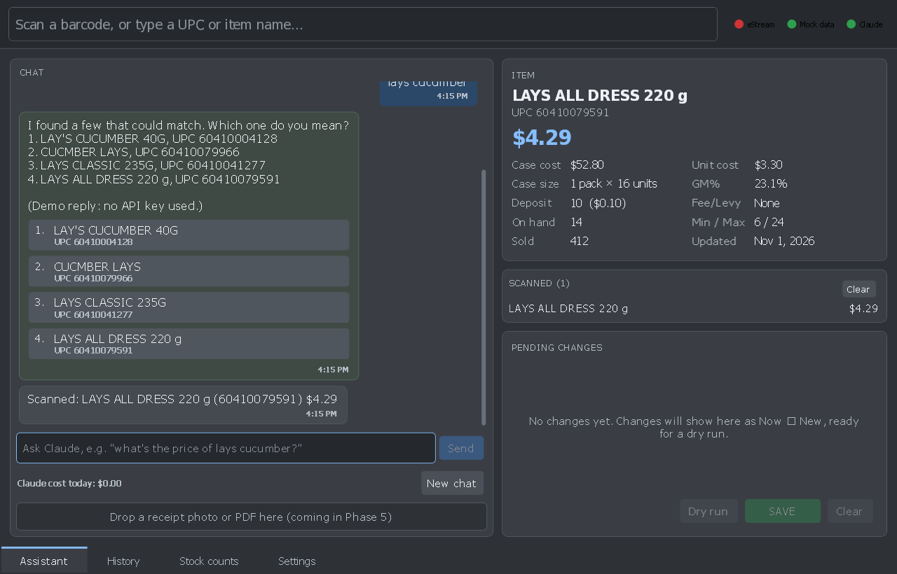
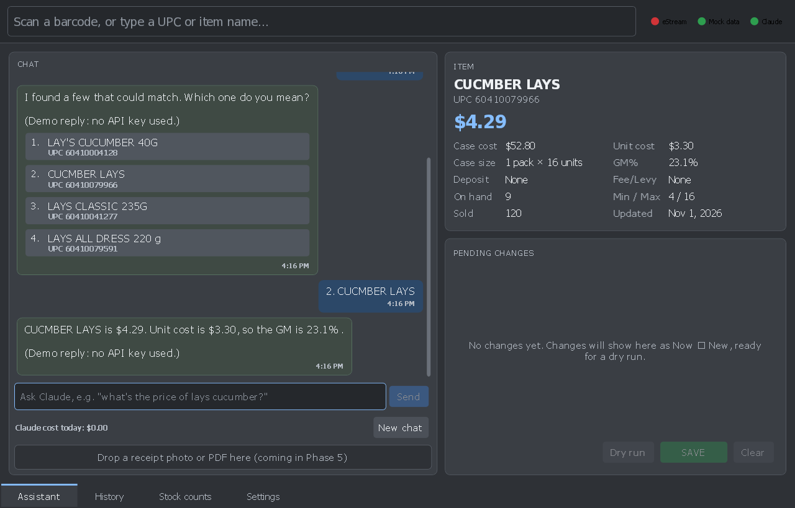
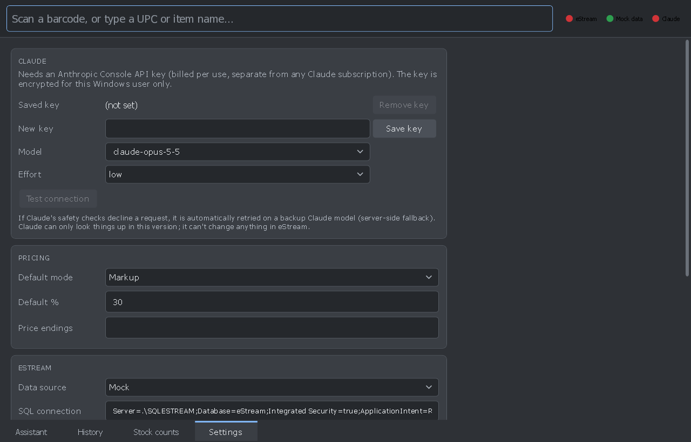

# eStream Assistant

Windows 11 desktop app for a store running eStream System 5. See `spec.md` (the requirements).
The original `Plan.txt` from the store PC is kept locally and is git-ignored, because it describes the store's setup.

## Layout

| Project | What it is |
|---|---|
| `src/EstreamAssistant.Core` | All the logic, cross-platform (`net10.0`): UPC normalization, fuzzy search, pricing math, scan detection, read-only SQL + mock repositories, name cache, settings. |
| `src/EstreamAssistant.App` | WPF app (`net10.0-windows`). Compiles on Linux, **runs only on Windows**. |
| `tests/EstreamAssistant.Tests` | xUnit tests for Core. |

## Build and test (any OS)

```
dotnet build
dotnet test
```

## Quick look on Linux (Wine)

```
tools/run-in-wine.sh                      # just open it
tools/run-in-wine.sh --search "lays cucumber" --pick 2 --scan 060410079591 --tab 3
tools/run-in-wine.sh --demo-chat --chat "lays cucumber" --choose 2
```

The `--search`, `--pick`, `--scan`, `--chat`, `--choose` and `--tab` options are for demos only: they feed
input to the app after it starts. `--demo-chat` swaps Claude for a scripted stand-in that uses the real
read-only tools, so the chat can be checked without an API key or any cost. Wine is fine for checking layout,
but focus handling and scanner timing need a real Windows PC.

| Chat with numbered choices | After picking a choice | Settings |
|---|---|---|
|  |  |  |

## Install on the store PC

Download the latest `eStreamAssistant-Setup-<version>.exe` from
[Releases](https://github.com/PocketStudiosLLC/Estream-Assistant/releases) and run it as the normal store user
(no admin needed). It installs to `C:\eStreamAssistantApp\`, and the store PC doesn't need .NET.
To update, run the newer installer. Settings and the API key are kept.

## Making a release (dev PC)

1. Set `<Version>` in `src/EstreamAssistant.App/EstreamAssistant.App.csproj` and write `docs/releases/v<version>.md`.
2. Commit, then `git tag v<version> && git push origin main v<version>`.
3. GitHub Actions (`.github/workflows/release.yml`) runs the tests, builds the installer with Inno Setup and
   publishes the release, with SHA256SUMS. Versions starting with `0.` are marked as pre-releases.

Until the workflow files are pushed (that needs `gh auth refresh -h github.com -s workflow` on the dev PC), releases
are built locally with the script below and uploaded with `gh release create`.

To try the installer locally first: `tools/build-installer-wine.sh` (Inno Setup under Wine; see the script for
the one-time setup). Output goes to `dist/`.

The plain self-contained exe, without an installer:
`dotnet publish src/EstreamAssistant.App -c Release -r win-x64 -o publish/win-x64`

## Data source

- **Mock** (default): built-in sample items. Only the first two UPCs/names are real; all prices are made up.
  You can point *Settings → Sample export* at a `sample-items.txt` made with the sqlcmd command in Plan.txt §12.
  That file is store data: it's git-ignored, so keep it private.
- **Sql** (on the store PC): the real eStream database, **read-only** (`ApplicationIntent=ReadOnly` is forced,
  and only built-in SELECT statements can run).

App files (settings, encrypted API key, name cache, logs) live in `%LOCALAPPDATA%\eStreamAssistant\`.

## Status (build phases from Plan.txt §13)

- [x] **Phase 1**: shell window, settings (API key encrypted with DPAPI), UPC lookup with check-digit fallbacks,
      fuzzy name search with numbered choices, scanner detection, item card, scan list, eStream/DB status lights.
      Pricing math is also built and tested (used from Phase 3).
- [x] **Phase 2**: Claude chat (`claude-opus-5-5`, streaming) with read-only tools only: `lookup_item`, `find_items`,
      `get_codes`, `calc_price` (strict schemas, inputs re-checked in the app). The system prompt and tools are
      prompt-cached; effort comes from Settings (default low). Server-side fallback (`fallbacks: "default"`)
      retries safety-classifier refusals on a backup model. Numbered choices in Claude's replies become buttons;
      scans are passed to Claude as context. There is a cost estimate in the chat footer (`usage.json`), plus
      *Test connection* and *New chat*. Tested end to end against a local fake API server; **not yet tried with
      a real API key.**
- [ ] Phase 3: pending changes, validation, dry run via the PowerShell scripts
- [ ] Phase 4: SAVE + history
- [ ] Phase 5: receipts
- [ ] Phase 6: stock counts
- [ ] Phase 7: store-PC acceptance

## To check against the real scripts (TODOs in the code)

The `C:\eStreamAutomation` folder hasn't been copied to the dev PC yet. When it is:
- `FuzzyMatcher.StopWords`: copy the exact list from `Get-EsItem.ps1 -Find`.
- `UpcNormalizer`: compare edge cases with `Get-EsItem.ps1`.
- Results CSV status strings: read them from `Invoke-EsCsv.ps1` (needed for Phase 3).
