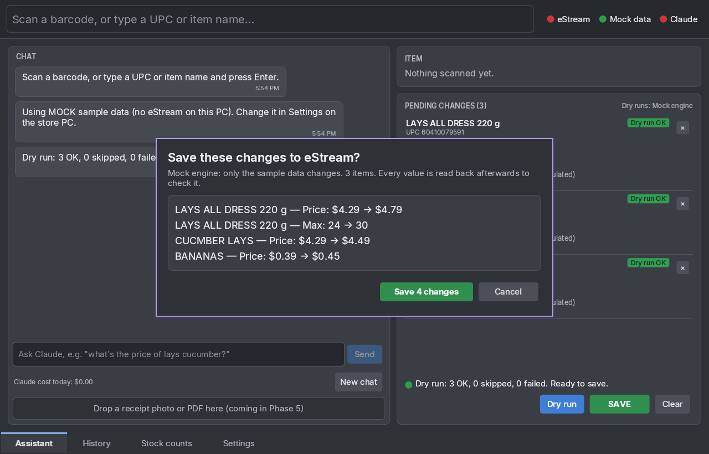
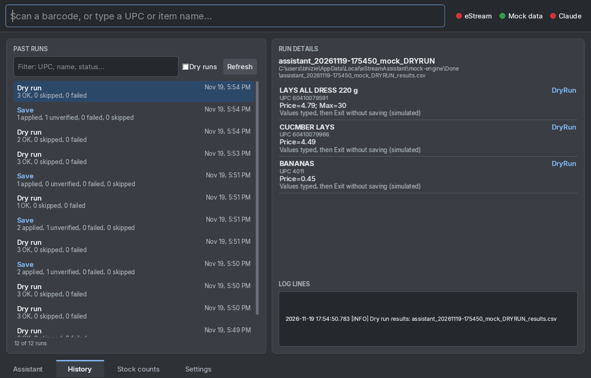
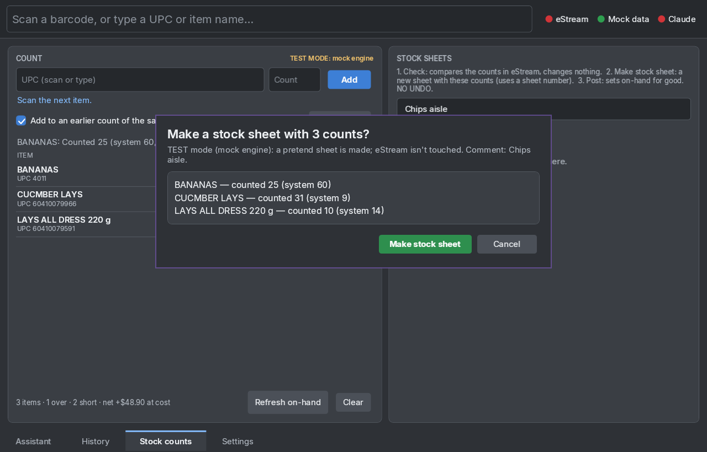
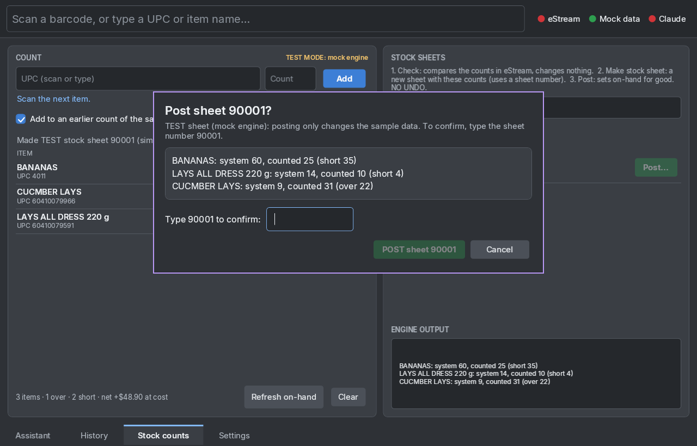

# eStream Assistant

Windows 11 desktop app for a store running eStream System 5. See `spec.md` (the requirements).
The original `Plan.txt` from the store PC is kept locally and is git-ignored, because it describes the store's setup.

## Layout

| Project | What it is |
|---|---|
| `src/EstreamAssistant.Core` | All the logic, cross-platform (`net10.0`): UPC normalization, fuzzy search, pricing math, scan detection, read-only SQL + mock repositories, name cache, settings. |
| `src/EstreamAssistant.App` | WPF app (`net10.0-windows`). Compiles on Linux, **runs only on Windows**. |
| `tests/EstreamAssistant.Tests` | xUnit tests for Core. |

## Build and test (any OS)

```
dotnet build
dotnet test
```

## Quick look on Linux (Wine)

```
tools/run-in-wine.sh                      # just open it
tools/run-in-wine.sh --search "lays cucumber" --pick 2 --scan 060410079591 --tab 3
tools/run-in-wine.sh --demo-chat --chat "lays cucumber" --choose 2
tools/run-in-wine.sh --stage "060410079591:price=4.79,max=30" --stage "60410079966:price=9.99" --dryrun
tools/run-in-wine.sh --mock-unverified 60410079966 --stage "060410079591:price=4.79" --stage "60410079966:price=4.49" --dryrun --save --tab 1
tools/run-in-wine.sh --tab 2 --count 060410079591=10 --count 4011=25 --make-sheet "Chips aisle" --post-first
```

The `--search`, `--pick`, `--scan`, `--chat`, `--choose`, `--stage`, `--dryrun`, `--save` (auto-confirms), `--save-dialog`,
`--mock-unverified`, `--mock-fail`, `--count`, `--make-sheet` (auto-confirms), `--post-first` (opens the real
post dialog), `--edit` and `--tab` options are for demos only: they feed
input to the app after it starts. `--demo-chat` swaps Claude for a scripted stand-in that uses the real
read-only tools, so the chat can be checked without an API key or any cost. Wine is fine for checking layout,
but focus handling and scanner timing need a real Windows PC.

| Chat with numbered choices | After picking a choice | Settings |
|---|---|---|
|  |  |  |

| Pending changes after a dry run | Changing an item on the item card |
|---|---|
|  |  |

| SAVE confirmation | History |
|---|---|
|  |  |

| Make a stock sheet | Post a stock sheet (type the number) |
|---|---|
|  |  |

## Install on the store PC

Download the latest `eStreamAssistant-Setup-<version>.exe` from
[Releases](https://github.com/PocketStudiosLLC/Estream-Assistant/releases) and run it as the normal store user
(no admin needed). It installs to `C:\eStreamAssistantApp\`, and the store PC doesn't need .NET.
To update, run the newer installer. Settings and the API key are kept.

## Making a release (dev PC)

1. Set `<Version>` in `src/EstreamAssistant.App/EstreamAssistant.App.csproj` and write `docs/releases/v<version>.md`.
2. Commit, then `git tag v<version> && git push origin main v<version>`.
3. GitHub Actions (`.github/workflows/release.yml`) runs the tests, builds the installer with Inno Setup and
   publishes the release, with SHA256SUMS. Versions starting with `0.` are marked as pre-releases.

Until the workflow files are pushed (that needs `gh auth refresh -h github.com -s workflow` on the dev PC), releases
are built locally with the script below and uploaded with `gh release create`.

To try the installer locally first: `tools/build-installer-wine.sh` (Inno Setup under Wine; see the script for
the one-time setup). Output goes to `dist/`.

The plain self-contained exe, without an installer:
`dotnet publish src/EstreamAssistant.App -c Release -r win-x64 -o publish/win-x64`

## Data source

- **Mock** (default): built-in sample items. Only the first two UPCs/names are real; all prices are made up.
  You can point *Settings → Sample export* at a `sample-items.txt` made with the sqlcmd command in Plan.txt §12.
  That file is store data: it's git-ignored, so keep it private.
- **Sql** (on the store PC): the real eStream database, **read-only** (`ApplicationIntent=ReadOnly` is forced,
  and only built-in SELECT statements can run).

App files (settings, encrypted API key, name cache, logs) live in `%LOCALAPPDATA%\eStreamAssistant\`.

## Status (build phases from Plan.txt §13)

- [x] **Phase 1**: shell window, settings (API key encrypted with DPAPI), UPC lookup with check-digit fallbacks,
      fuzzy name search with numbered choices, scanner detection, item card, scan list, eStream/DB status lights.
      Pricing math is also built and tested (used from Phase 3).
- [x] **Phase 2**: Claude chat (`claude-opus-5-5`, streaming) with read-only tools only: `lookup_item`, `find_items`,
      `get_codes`, `calc_price` (strict schemas, inputs re-checked in the app). The system prompt and tools are
      prompt-cached; effort comes from Settings (default low). Server-side fallback (`fallbacks: "default"`)
      retries safety-classifier refusals on a backup model. Numbered choices in Claude's replies become buttons;
      scans are passed to Claude as context. There is a cost estimate in the chat footer (`usage.json`), plus
      *Test connection* and *New chat*. Tested end to end against a local fake API server; **not yet tried with
      a real API key.**
- [x] **Phase 3** (not yet released): pending changes list, filled by Claude (`stage_changes`) or by **Change…** on the item card.
      Every row is checked with the S7 safety rules. Rows that fail stay visible as *Skipped* with the reason.
      Large changes need the owner's **Allow large change** (Force=Y); Claude can't set it.
      **Dry run** (button or Claude's `run_dry_run`) uses the mock engine or `Invoke-EsCsv.ps1 -DryRun` (Settings → *Dry runs with*),
      behind a full-window "don't touch" overlay. SAVE turns on only when the current list just passed a dry run; any add,
      edit or remove turns it off again.
      **To check on the store PC:** the exact status strings in the results CSV, where `Done\` results land for a `-Path`
      outside `Inbox\`, and whether Force also covers the 50% price/cost rule.
- [x] **Phase 4** (not yet released): **SAVE** shows every change as `Item — Field: Now → New` (Cancel is the default), then runs
      `Invoke-EsCsv.ps1 -Path` from `Inbox\` with exactly the CSV that passed the dry run (SHA-256 checked). The app then reads
      every value back from the database: a mismatch makes the row *Unverified*, with the values it found. An apply is
      never cancelled half-way. A save cut off by a crash is reported at the next start and listed in History; nothing
      is re-applied. **History** lists `Done\` results (newest first, filter, dry runs on/off), the rows, and matching log lines.
      Mock saves change only the sample data. The overlay shows elapsed and expected time; *Stop after current item*
      (U8) needs progress output from the scripts, so it's still to do.
- [ ] Phase 5: receipts
- [x] **Phase 6** (not yet released): **Stock counts** tab. With the tab open, a scan picks the item, then type the count
      and press Enter (counts of the same item can add up); or import a `UPC,Count` CSV; or Claude adds counts you give it
      (`stock_count_preview`). Each row shows counted, system on-hand and over/short (with value at cost); the list is kept
      if the app closes. **Check** runs `New-EsStockSheet.ps1 -Check` (changes nothing). **Make stock sheet** asks first
      (it uses a sheet number), refuses counts that were already imported (imports add up in eStream), and records the
      sheet number. **Post** is a button only: a `Publish-EsStockSheet.ps1 -DryRun` check, then a window where you must
      type the sheet number (Enter does nothing until it matches), then the real post. Only sheets this app made can be
      posted, once; sheets in Settings → *Protected sheets* never. The first real post is flagged as one to watch.
      The mock engine makes TEST sheets (90001…) that only change the sample data.
- [ ] Phase 7: store-PC acceptance

## To check against the real scripts (TODOs in the code)

The `C:\eStreamAutomation` folder hasn't been copied to the dev PC yet. When it is:
- `FuzzyMatcher.StopWords`: copy the exact list from `Get-EsItem.ps1 -Find`.
- `UpcNormalizer`: compare edge cases with `Get-EsItem.ps1`.
- Results CSV status strings: read them from `Invoke-EsCsv.ps1` (needed for Phase 3).
